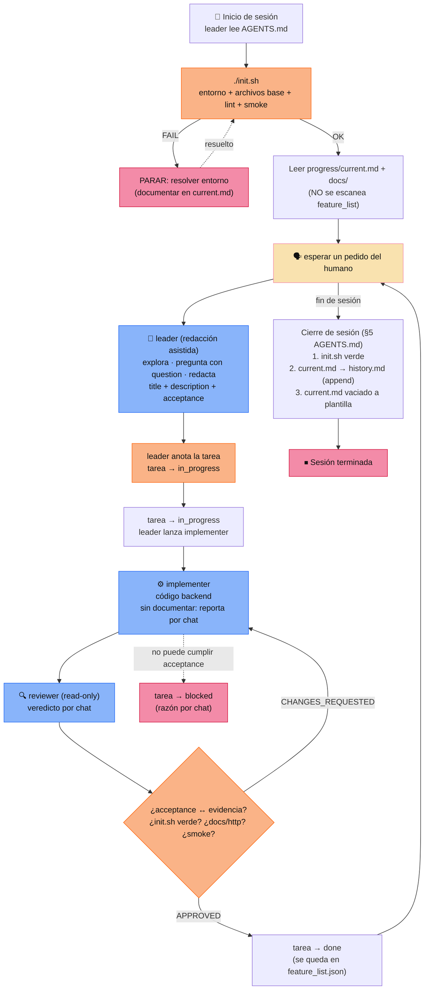

# Flujo completo del arnés (por tareas)

> Versión ampliada con el contexto que lee cada subagente:
> [`harness-flujo-completo.md`](./harness-flujo-completo.md).

Claves:

- Al iniciar **no se escanea `feature_list.json`**: el trabajo llega **solo por
  un pedido del humano**. Solo se toca ese archivo al crear o actualizar una
  tarea.
- **Redacción asistida:** el humano describe la idea en bruto; el leader
  explora, pregunta (`question`) y redacta `title`/`description`/`acceptance`.
- Hay **un solo camino**: `pending → in_progress → [implementer → reviewer] →
  done`. Sin spec previo ni puerta de aprobación.
- `reviewer → implementer` es un ciclo de rechazo hasta cumplir el
  `acceptance` de la tarea.
- El `leader` anota, coordina y marca `done`, pero **no codifica**: delega en
  el `implementer`.
- **El implementer y el reviewer no documentan**: devuelven su resultado por
  chat. El leader es el único que escribe en `progress/current.md`.
- La tarea `done` **se queda** en `feature_list.json`; el leader no sale a
  buscar pendientes: vuelve a **esperar un pedido**.
- El `implementer` puede terminar **`blocked`** (se detiene y reporta la
  razón).
- `init.sh` aparece dos veces (entrada y salida) como guardián ejecutable
  (lint + smoke). Las tareas que agregan endpoints extienden
  `scripts/smoke.js`.
