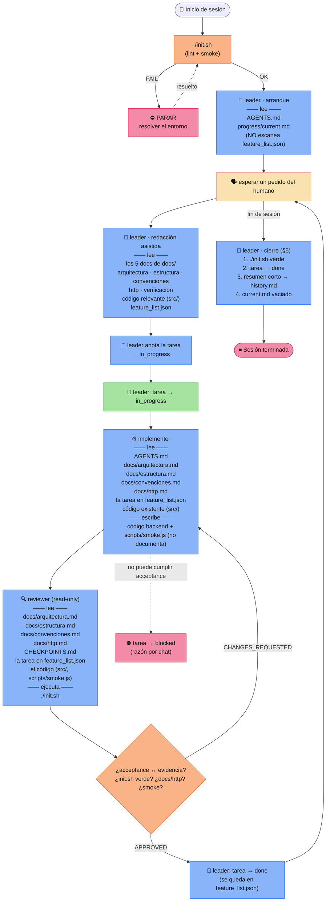

# Flujo completo del arnés + contexto que lee cada agente

Versión ampliada de [`harness-flow.md`](./harness-flow.md): mismo flujo, pero
mostrando **qué archivos lee cada agente para tomar contexto antes de actuar**
(y qué escribe).

## Contexto por agente

| Agente | Lee (contexto) | Escribe |
|---|---|---|
| **leader** (arranque) | `AGENTS.md`, `progress/current.md` | — |
| **leader** (redacción) | los 5 `docs/`, código relevante (`src/`), `feature_list.json` | la tarea en `feature_list.json`, `progress/current.md` |
| **implementer** | `AGENTS.md`, `docs/arquitectura.md`, `docs/estructura.md`, `docs/convenciones.md`, `docs/http.md`, la tarea, el código existente | código backend + `scripts/smoke.js` (**no documenta**) |
| **reviewer** | `docs/arquitectura.md`, `docs/estructura.md`, `docs/convenciones.md`, `docs/http.md`, `CHECKPOINTS.md`, la tarea, el código; ejecuta `./init.sh` | **nada** (read-only; veredicto por chat) |

## Los 5 docs obligatorios de `docs/`

`arquitectura.md` · `estructura.md` · `convenciones.md` · `http.md` ·
`verificacion.md`

Claves:

- Cada subagente arranca leyendo los `docs/` que le corresponden **antes** de
  escribir o juzgar: el `implementer` y el `reviewer`, además, `http.md` y
  `CHECKPOINTS.md`.
- El `reviewer` es el único que **no escribe nada**: lee el código y emite su
  veredicto por chat.
- Cada endpoint nuevo o modificado debe quedar cubierto por
  `scripts/smoke.js`; `./init.sh` corre lint + smoke.
