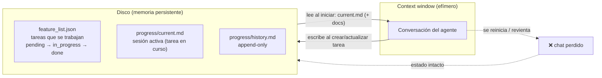

# Memoria del arnés: disco vs chat

| Memoria | Archivo | Ciclo |
|---|---|---|
| Qué se está trabajando | `feature_list.json` (`tareas[].status`); las `done` quedan como registro | Se toca al crear/actualizar; **no se escanea al iniciar** |
| Sesión en curso | `progress/current.md` (tarea en curso) | Se vacía al cerrar |
| Historial | `progress/history.md` (append-only) | Nunca se borra |
| Estado verificable | `./init.sh` (lint + smoke) + `scripts/smoke.js` + control de versiones | Se regenera, no se memoriza |

El `implementer` y el `reviewer` **no escriben en `progress/`**: devuelven su
resultado por chat. Por eso no hay informes `impl_`/`review_`.

Ciclo: al empezar el agente lee `current.md` (+ `docs/`) y **no** escanea
`feature_list.json`; al cerrar, mueve el resumen de `current.md` al final de
`history.md` y lo vacía (§5). Por eso las sesiones son retomables aunque
revienta la ventana de contexto.
